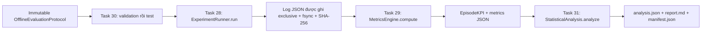

# Task 28-31: pipeline đánh giá ngoại tuyến

> Đường dẫn source đã chuyển ngày 2026-10-14; xem [bản đồ thư mục](../repository-layout.md). Receipts, command invocations và hash/path lịch sử bên dưới thuộc source trước khi chuyển. Các liên kết tới source và ví dụ import Python đã theo vị trí mới.

Implementation subset: `IMPLEMENTED`; independent review và live evaluation:
`UNRESOLVED`. Không thay trạng thái Task 28-31 trong TASKS.md (`SPEC_ONLY`),
Task 26/32 vẫn `DEFERRED`. Phạm vi phiên này: script điều phối, tài liệu thiết kế,
focused tests và artifact replay mới trong `runtime/**`.

## Kiến trúc và luồng dữ liệu



Entry point là [evaluate_all.py](../../runtime/evaluation/evaluate_all.py). Module gọi trực tiếp API replay
hiện có tại [offline_evaluation.py](../../runtime/evaluation/offline_evaluation.py), tái dùng công thức
`goal_success_rate` trong `evaluation/metrics/formulas.py`.

```python
for split in ("validation", "test"):
    for candidate in CANDIDATES:
        log_ref = runner.run(protocol, candidate, split, store)
        rows, metrics_ref = metrics.compute(
            store, log_ref, protocol, candidate, split, cost_per_step
        )
        all_rows.extend(rows)
analysis = StatisticalAnalysis().analyze(all_rows, protocol, alpha=alpha)
```

Standard evaluation ánh xạ sang `validation`; held-out ánh xạ sang `test`.
Tập train chỉ được dùng để kiểm tra disjointness/fingerprint, không thực thi.
Task 30 là bước chọn split trong orchestrator, dùng validation của
`OfflineEvaluationProtocol`: khác IDs, family và semantic content; cùng số asset,
ngân sách decision và tick rate. Không âm thầm thay canonical scenario manifest.

Runner chỉ chạy hai selector metadata cố định, stateless: `synthetic-review` và
`synthetic-random`. Không nhận callback, tên module hoặc executor từ CLI. Fingerprint
của selector được lưu trước cả hai split; không tuning, training hoặc truyền metrics
trở lại selector. Runner hiện có chỉ đưa detached observations, mask và seeded RNG
cho selector, không đưa fixture IDs, environment hoặc dữ liệu chưa được quan sát.
Đây là phân tách replay có cấu trúc, không phải sealed test service cho model ngoài.

Mỗi episode tạo/reset/close simulator riêng. Simulator giữ các check replay về lab,
target/operation approval, order, rate và budget. Replay approval không cấp quyền
network dispatch. Fixture vốn immutable nên reset không đòi thay đổi/restore target
thật. Live restore và centralized live gate integration vẫn `UNRESOLVED`.

## Dữ liệu giữa các module

| Bước | Input | Output |
|---|---|---|
| Runner | Protocol, candidate, split | `ArtifactRef(name, sha256)` tới log JSON |
| Metrics | Ref, protocol, cost model | Tuple `EpisodeKPI`, ref metrics JSON |
| Statistics | Đủ KPI cho mọi candidate/split/fixture/seed | Summaries, CI, paired tests, gap |
| Report | Analysis và protocol | Markdown, JSON, manifest hashes |

Log có envelope riêng, schema version 2: UTC, run ID, source `SIMULATED_FIXTURE`, redaction
`METADATA_ONLY`, expected state và observed state tách biệt. Ref kiểm hash toàn bộ
file trước parse. Metrics kiểm schema đóng, identity, fingerprint, đủ episode grid,
unique keys, outcome/counters và success có kết quả terminal hỗ trợ. Metadata schema
đóng không nhận credentials hoặc log raw. Artifact là dữ liệu đánh giá dẫn xuất,
không giả vờ đã được duyệt theo canonical evidence schema.

Success là `REVIEW_COMPLETE` của **metadata review**, không phải khả năng phát hiện
lỗ hổng hoặc phòng thủ thực tế. Steps đếm transition đã commit; malformed proposals
không tạo transition, còn counter riêng trong log. Cost = steps × cost-per-step,
đơn vị credit mô hình; tiền/token/provider cost chưa được đo (`null`). Tất cả episode
lỗi, refusal, STOPPED_EARLY và budget exhaustion vẫn trong denominator, exclusions=0.

Mỗi run dùng thư mục UUID mới, file tạo `xb`, flush/fsync; không ghi đè hoặc xóa run
dở dang. Lỗi runner/log/hash/schema/write làm dừng các bước tiếp theo. Không có
manifest hoàn tất nếu pipeline chưa đi hết. ArtifactStore kiểm containment,
symlinks và Windows junctions; yêu cầu trusted single writer. Chưa chứng minh chống
hostile concurrent path replacement hoặc directory durability khi mất điện.

## Phương pháp thống kê

Baseline = review; candidate = random. Trong **mỗi split**, lấy trung bình từng KPI
qua mọi scenario cho từng seed, rồi ghép candidate/baseline cùng seed. Không coi
từng step hoặc mọi scenario × seed là các quan sát độc lập để tăng cỡ mẫu. Difference
là candidate − baseline. Paired t-test hai phía kiểm H0: trung bình difference = 0,
báo t, df, p, CI cho delta và CI cho seed means.

Có sáu hypothesis đăng ký trước: ba KPI × hai split. Holm correction tính cả
hypothesis không kiểm định được trong family; CI là marginal, chưa hiệu chỉnh
simultaneous coverage. Ít hơn hai seed hoặc difference variance bằng 0 trả trạng thái
tương ứng, p/reject=`null`, không xuất NaN/Inf hoặc kết luận significance giả.

Điều kiện diễn giải: seed units độc lập và paired differences gần normal; success
rate theo seed là xấp xỉ và CI có thể ra ngoài [0,1]. Lặp nhiều seed cho một policy
deterministic không bổ sung evidence độc lập. Khoảng [mean,mean] chỉ mô tả mẫu hằng.
Chi phí tỷ lệ với steps nên không phải hỗ trợ thống kê độc lập. Suy luận chỉ có điều
kiện trên tập scenario cố định; chưa suy luận ra population scenario.

Không ghép standard scenario với held-out scenario để t-test vì hai tập khác nhau.
Generalization gap held-out − standard được báo cáo mô tả riêng. Large p không
chứng minh equivalence; chỉ reject H0 khi Holm p < alpha và test `COMPUTED`.

Nguồn phương pháp/API: tài liệu chính thức SciPy, `scipy.stats.ttest_rel`, đã đọc
trong phiên này. Field `inference_state` mô tả kết quả phương pháp thống kê, không
là `status` task/artifact theo vocabulary của dự án. Không mở quyền sửa source
register ngoài allowlist; URL phương pháp được cung cấp trong bàn giao chat.

## Cách sử dụng

Từ repository root, chạy demo hoàn toàn ngoại tuyến:

```powershell
python -B -m runtime.evaluate_all --demo
python -B -m runtime.evaluate_all --demo --cost-per-step 2 --alpha 0.05
```

CLI chỉ cho output trong `runtime/evaluation-runs`; mỗi lần tự tạo run mới. Python
API nhận protocol replay đã validate và output parent rõ ràng:

```python
from pathlib import Path
from runtime.evaluation.evaluate_all import demo_protocol, evaluate_all

report_dir = evaluate_all(
    demo_protocol(), Path("runtime/evaluation-runs"), cost_per_step=1.0, alpha=0.05
)
```

Dependencies hiện có: Gymnasium, NumPy và SciPy (SciPy >=1.10 cho `ttest_rel.df`).
Không cài/thay package trong phiên này; phiên bản thực tế và source hashes được ghi
trong configuration/manifest của từng run. Chưa có dependency lock dành riêng cho
pipeline. Model identity thật, provider costs, canonical EXP/SCN integration và
live defensive benchmark không được giả định từ demo.

## Checks và handoff

Receipts ghi ngày 2026-10-12; checkpoint bàn giao 10:13:03 UTC. Mọi Python command
dùng `-B`; không tạo bytecode cho pipeline. Python 3.14.5, Gymnasium 1.4.0,
NumPy 2.5.3, SciPy 1.18.1 được quan sát trong môi trường hiện có.

| Command / check thực tế | Exit | Observed result |
|---|---:|---|
| `python -B -m unittest discover -s tests/runtime -p test_evaluate_all.py -v` — lần đầu | 1 | 12 tests; 1 error ở test fixture tuple không hỗ trợ assignment; sửa helper serialize fixture |
| Cùng command — sau fix fixture | 0 | 12 tests PASS |
| Cùng command — bản cuối, bổ sung multi-scenario aggregation | 0 | 13 tests PASS; zero network/process sentinel; log hash, grid, failure/write/order checks |
| `python -B -m unittest discover -s tests/runtime -p test_offline_evaluation.py -v` | 0 | 14 tests PASS, runner/protocol regression |
| `python -B -m unittest discover -s tests/evaluation -p test_metrics.py -v` | 0 | 7 tests PASS, metric/ground-truth/contract regression |
| `python -B -m runtime.evaluate_all --demo` — lần đầu | 1 | STOPPED_EARLY thiếu trong reader schema; dừng trước random metrics, giữ 4 artifacts |
| Cùng command — sau bổ sung outcome | 0 | RUN-EVAL-2c8fc0463d9144419e2de854d5e76d84; hoàn tất offline, artifact v1 được giữ |
| Cùng command — bản cuối | 0 | RUN-EVAL-db2d8184ca0449abb358a3f7646f91cb; artifact v2, 20 episodes, 6 planned tests |
| `python -B scripts/validation/validate_scaffold.py` — lần đầu | 1 | 32 errors: 27 có sẵn, 5 ở docs/derived outputs phiên này |
| Cùng command — sau fix format | 1 | 31 errors: 27 có sẵn, 4 ở artifacts v1 được giữ; 0 errors ở source/test/docs hoặc run v2 |
| `git diff --check -- runtime/evaluate_all.py runtime/evaluate_all.md tests/runtime/test_evaluate_all.py` | 0 | Không whitespace errors; đây là new untracked files nên kiểm riêng bên dưới |
| `python -B -c` AST/whitespace/EOF check | 0 | `ast.parse` 2 Python files; 3 source/docs/tests không trailing whitespace và đều kết thúc newline |
| `python -B -c` manifest integrity check | 0 | Run v2: 11/11 hashes khớp, 6 tests, `inference_state` thay `status` |

Tổng final suites: **34 tests PASS**. Không dùng receipt FAIL cũ làm PASS. Source
Python không đổi sau final suites/demo; phần này bổ sung receipts và inventory.
Run v2 báo synthetic-review 5/5 success, 3 steps và 3 credits ở mỗi split;
synthetic-random 2/5 success, mean 2.6 steps/credits ở mỗi split. Không reject H0
cho cả sáu comparisons sau Holm. Đây là quan sát demo, không chứng minh chất lượng
phòng thủ hoặc generalization thực tế; năm seed và một scenario/split là mẫu rất nhỏ.

### Exact changed/deleted files

Ba file source/docs/tests **được thêm mới**; không sửa existing source:

```text
E:/PBL6_FINAL/runtime/evaluate_all.py
E:/PBL6_FINAL/runtime/evaluate_all.md
E:/PBL6_FINAL/tests/runtime/test_evaluate_all.py
```

28 artifacts được thêm mới. Run đầu dở dang tại
`E:/PBL6_FINAL/runtime/evaluation-runs/RUN-EVAL-28f2ce10b1e24f0c867f3980e0212c5a/`
chỉ có đúng bốn file:

```text
configuration.json
validation-synthetic-review.log.json
validation-synthetic-review.metrics.json
validation-synthetic-random.log.json
```

Hai run hoàn tất dưới đây **mỗi run** có đúng 12 file cùng tên được liệt kê:

```text
E:/PBL6_FINAL/runtime/evaluation-runs/RUN-EVAL-2c8fc0463d9144419e2de854d5e76d84/
E:/PBL6_FINAL/runtime/evaluation-runs/RUN-EVAL-db2d8184ca0449abb358a3f7646f91cb/
```

```text
configuration.json
validation-synthetic-review.log.json
validation-synthetic-review.metrics.json
validation-synthetic-random.log.json
validation-synthetic-random.metrics.json
test-synthetic-review.log.json
test-synthetic-review.metrics.json
test-synthetic-random.log.json
test-synthetic-random.metrics.json
analysis.json
report.md
manifest.json
```

Deleted files: **none**. Không sửa contracts/configuration/catalog/scenarios,
historical evidence, TASKS.md, PROJECT_CONTEXT.md, PROJECT_PLAN.md, history hoặc
thay đổi có sẵn của người dùng. Không commit, self-approve hoặc finalize.

### Blockers và unverified items

`HANDOFF_BLOCKED` — repository gate chưa đạt. 27 lỗi có sẵn gồm
`.demo-session.json` có status READY và 26 bytecode artifacts. Bốn lỗi phiên này
được giữ trong run v1: `analysis.json` dùng ba trạng thái phương pháp dưới key
`status` bị checker coi là task status; `report.md` chứa external URL ngoài
source register. Format run v2 phân biệt `inference_state` và bỏ external URL
trong file; vẫn mô tả tên nguồn phương pháp. Không sửa validator hoặc ghi đè/xóa
run v1 để làm gate xanh. Cần quyết định phạm vi bảo toàn/chuyển lưu artifacts v1
và xử lý gate blockers trước review; run v1 không phải handoff chính.

Independent review, canonical EXP/SCN/evidence-contract integration, source binding
cho toàn bộ transitive dependencies, dependency lock, real model/checkpoint freeze,
sealed held-out service, monetary cost, live isolation/restore và defensive benchmark
vẫn `UNRESOLVED`. Không có runtime-success hoặc deployment claim.

### Pending handoff payload

```text
build_id: BUILD-EVAL-OFFLINE-V2-20261012
user_scope: Task 28-31 offline orchestration; no live execution
plan_id: UNRESOLVED (không tự tạo approved plan/contract)
observed_head_at_handoff: d9ae6ca0d5bb03ce381d7249665237f272eeddc9
working_tree: dirty; existing user work preserved
allowed_paths: runtime/**, focused tests/runtime/**
handoff_state: HANDOFF_BLOCKED
blocker: REPOSITORY_CHECKER_FAILED; 27 existing + 4 preserved v1 artifact errors
primary_run: RUN-EVAL-db2d8184ca0449abb358a3f7646f91cb
source_sha256 runtime/evaluate_all.py:
  a0d37b583ee641f373ecbf1de0a8469970d14f39e835b80b609b21b274e07903
source_sha256 tests/runtime/test_evaluate_all.py:
  f662d99e2eaddbd9611b72734088fc47bd2df607bea14e8b1b30cc550547dc73
required_receipts: 13 + 14 + 7 tests PASS, AST/whitespace PASS, demo/integrity PASS
repository_gate: FAIL (exit 1), no review dispatched
deleted_files: none
review_request_pending: data flow, split isolation, costs, failure accounting,
  paired seed units, Holm/CI assumptions, artifact preservation and provenance
next_step: resolve gate/artifact retention within approved scope, then independent review
```
