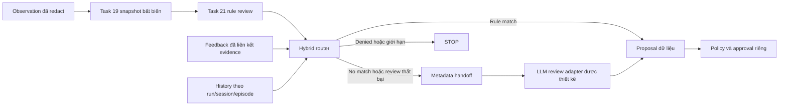

# Task 27 — Thiết kế điều phối hybrid ngoại tuyến

> Đường dẫn source đã chuyển ngày 2026-10-14; xem [bản đồ thư mục](../repository-layout.md). Receipts, command invocations và hash/path lịch sử bên dưới thuộc source trước khi chuyển. Các liên kết tới source và ví dụ import Python đã theo vị trí mới.

## Status

Reference routing artifact: `IMPLEMENTED`; chưa `VALIDATED`.
Canonical TASK-027 là `IMPLEMENTED` cho subset này theo yêu cầu đồng bộ tài liệu
ngày 2026-10-12; chưa `VALIDATED`. Full hybrid runtime giữ `SPEC_ONLY`; đây là bản
thiết kế và router thuần cho metadata review, chưa phải hybrid backend tích hợp. Provider/coordinator/gate/
recorder integration và independent review: `UNRESOLVED`.

## Phạm vi và nguồn

[Router](../../runtime/planners/hybrid_router.py) chỉ trả quyết định điều hướng và JSON handoff;
[tests](../../tests/runtime/test_hybrid_router.py) dùng synthetic fixtures.
Không gọi planner/provider, không sửa store hoặc trừ budget. Chỉ chấp nhận
candidate action `ACTION-PLAN-003` (xem xét bằng chứng ngoại tuyến), phù hợp phần
hiện có của [Task 21](../../runtime/planners/rule_based_planner.py) và [Task 22](../../runtime/planners/llm_planner.py).

Nguồn: [PROJECT_CONTEXT](../../PROJECT_CONTEXT.md), [PROJECT_PLAN](../../PROJECT_PLAN.md),
[TASKS](../../TASKS.md), [Task 27](../task-specs/TASK-027-hybrid-planner.md),
[interface Task 20](../../runtime/planners/planner_interface.py),
[state contract](../../agent/planner/contracts/state.schema.json),
[plan contract](../../agent/planner/contracts/plan.schema.json),
[ADR-004](../adr/ADR-004-bounded-action-catalog.md),
[ADR-005](../adr/ADR-005-planner-executor-perception-separation.md),
[ADR-006](../adr/ADR-006-shared-planner-interface.md),
[ADR-009](../adr/ADR-009-ground-truth-isolation.md),
[ADR-010](../adr/ADR-010-evidence-immutability.md),
[ADR-011](../adr/ADR-011-same-budgets-across-planners.md),
[ADR-012](../adr/ADR-012-safety-engine-control.md),
[ADR-013](../adr/ADR-013-runtime-vertical-slice.md).
Task 25 vẫn là dependency canonical của Task 27; RL arbitration và hybrid đầy đủ
chưa được triển khai trong bản thiết kế rule/LLM này.

## Kiến trúc



State store giữ observed facts và ngân sách. Coordinator giữ routing history
riêng, có context `(run_id, session_id, episode_id)`, replay từ evidence đã kiểm.
Router không có shared mutable memory, không sở hữu approval hoặc budget.
Coordinator đọc snapshot mới sau khi recorder đã ghi bền vững observation;
feedback vẫn liên kết revision của quyết định cũ. Revision mới có thể bằng cũ
khi observed state không đổi; đổi budget không chứng minh có tiến triển.

## Chính sách chuyển trạng thái

| Điều kiện | Kết quả router | Điều kiện consumer phải kiểm |
|---|---|---|
| Chưa có quyết định rule | `PLAN / RULE` | Gọi entry point đã validate của Task 21 |
| Rule match, phiên bản không bị chặn | `ACCEPT_RULE / RULE` | Proposal vẫn cần policy và approval |
| Rule không match hoặc match phiên bản đã bị chặn | `HANDOFF / LLM` | Có metadata candidate mới còn trong scope |
| Review `FAILURE`, `ERROR`, `PARTIAL` từ rule | `HANDOFF / LLM` | Feedback có observation IDs, đúng context/revision/action |
| Review thất bại từ LLM | `REPLAN / LLM` | Adapter kiểm toàn bộ lịch sử exclusion và revision |
| Review `SUCCESS` | `REPLAN / backend cũ` | Backend tự kiểm completion CONTROL; feedback alone chưa đủ |
| `DENIED` | `STOP / NONE` | Không chuyển backend để thử lại quyết định bị từ chối |
| Hết budget, scope thu hồi, hết candidate, vượt giới hạn | `STOP / NONE` | Không reset giới hạn khi đổi backend |

Không dùng confidence của LLM để cấp quyền hoặc quyết định rằng một hành động
an toàn. Không retry mù sau lỗi provider. Delegation là chọn backend trong
HYBRID; fallback là xử lý backend unavailable/timeout. Hai sự kiện cần provenance
riêng. `PlanningInput.fallback_allowed` không bị router tự bật.

## Memory handoff và adapter Task 22

Handoff chỉ gồm context IDs, objective/phase, revision, budget hiện hành,
metadata candidate, coverage và feedback. Không gửi raw fact values, HTML,
source code, ground truth hoặc exception text vào LLM context. Handoff tối đa
32 metadata candidates, có số lượng bị bỏ khỏi context; chưa có tokenizer thật
hoặc cam kết token-fit. Adapter phải áp dụng ContextLimits/token accounting của
Task 22 và dừng nếu mandatory fields không vừa.

Fingerprint candidate là SHA-256 của canonical JSON
`[context.key, objective_id, ACTION-PLAN-003, fact]`, cùng thuật toán Task 21/22.
Không phụ thuộc budget hoặc thứ tự facts. Snapshot revision và candidate version
có vai trò khác nhau: revision liên kết toàn input; version chống thử lại cùng
metadata. Hash không phải chữ ký hoặc bằng chứng xác thực.

RoutingHistory lưu các phiên bản đã thất bại/hoàn thành được coordinator xác nhận,
số lần chọn LLM và số bước không tiến triển; mặc định giới hạn 2 và 3. Mọi kết quả
chọn LLM, kể cả replan sau SUCCESS, đều cần reserve quota ở coordinator. Router
loại phiên bản vừa thất bại cùng các exclusions lịch sử. Fact thay đổi tạo version
mới, nhưng consumer vẫn phải xác minh nguồn observation và tiến triển liên quan.
Không giới hạn bằng cách xóa lịch sử cũ; history vượt 128 exclusions bị reject.
Giới hạn mẫu cần hiệu chỉnh, không phải kết quả thực nghiệm.

**Điểm tương thích:** `LLMPlanner._replan` hiện chỉ nhận original LLM decision có
`PLAN-022-*`; original RULE decision bị dừng. Vì vậy `HANDOFF` cần API adapter riêng
trong một integration tiếp theo. Không sửa requested/actual mode hoặc đổi
`PLAN-021-*` thành `PLAN-022-*` để qua kiểm tra. Gọi `LLMPlanner.plan()` trực tiếp
cũng chưa đủ: nó không nhận feedback/exclusion history của rule.

Adapter được thiết kế phải nhận typed PlanningInput + original backend decision +
Feedback + RoutingHistory; validate bindings trước tạo context, rồi chỉ cho phép
chọn candidate version trong handoff sau kiểm chứng completion/exclusion. Nó phải
giữ structured tool schema, refusal/incomplete status, revision binding và output
validation của Task 22. Code router chưa cài API adapter này, cũng không gọi private
Task 22 methods. `REPLAN / LLM` chưa thể dispatch trực tiếp vào backend hiện có khi
backend chưa kiểm toàn bộ history; consumer phải chặn output chọn excluded version.

Completion CONTROL hiện có namespace Task 21 và Task 22 riêng. Consumer phải kiểm
receipt/source integrity và xác nhận completed version trong history dùng chung;
không tự tạo receipt để chuyển quyền. Chỉ quay về rule sau một bước LLM thành công
khi cross-backend completion binding đã được triển khai/kiểm chứng. Bản router hiện
giữ original backend để kiểm completion, tránh báo thành công chỉ từ feedback.

Provider unavailable/timeout: mặc định dừng. Nếu fallback đã được cho phép, adapter
có thể xin rule candidate khác trong cùng mask/budget; ghi actual source, không
chọn lại candidate vừa thất bại hoặc biến provider refusal/malformed output thành
fallback. Router reject backend decisions đã fallback để consumer xử lý riêng,
vì deterministic fallback Task 22 không phải implementation Task 21.

## API tham chiếu

```python
from runtime.planners.hybrid_router import HybridReviewRouter, RoutingHistory

# request, previous và feedback là DTO đã validate của Task 20.
# history do coordinator đọc từ evidence đã kiểm, không nhận từ planner/LLM.
history = RoutingHistory(request.state.context)
route = HybridReviewRouter().route(
    request, history=history, previous=previous, feedback=feedback,
)
# route.operation là dữ liệu điều hướng. Không thực thi proposal tại đây.
```

Caller production không khởi tạo history rỗng trên mỗi vòng. Trước mỗi handoff,
coordinator cần reserve và ghi audit theo context để concurrent workers không
dùng cùng quota. Sau outcome đã ghi bền vững, update exclusions/counters; không
reset counters hoặc request/time budget khi chuyển backend. Các thao tác transaction,
concurrency, stale-state check, reference integrity và durable audit chưa tích hợp.

Mỗi proposal cuối cùng cần lab mode, canonical target/action allowlists, approval,
rate/order/budget, kill switch, audit và restore checks của policy hiện hành.
Candidate scopes trong PlanningInput/history không cấp quyền. Evidence cần UTC,
run ID, source, hash, redaction, expected/observed tách biệt; evidence-write failure
dừng. Bản thiết kế không ghi hoặc overwrite evidence.

## Checks và bàn giao

Build label: `BUILD-TASK027-ROUTER-REFERENCE-20261012` (nhãn phiên chưa được duyệt).
Source HEAD: `d9ae6ca0d5bb03ce381d7249665237f272eeddc9`; working tree đã dirty trước
phiên này. Receipt UTC: `2026-10-12T09:36:05.5800092Z`; nguồn kiểm thử:
`RUN-027-FIXTURE`/`SESSION-1`/`EPISODE-1`, synthetic offline fixture.
Không có provider-backed, Docker, scanner, executor hoặc independent-review receipts.

| Exact command | Exit | Observed |
|---|---|---|
| `python -B -m unittest discover -s tests/runtime -p test_hybrid_router.py -v` | 0 | 20 tests PASS ở lượt cuối; trước bổ sung kiểm tra history/candidate/compatibility có 16 rồi 17 tests PASS |
| `python -B -m unittest discover -s tests/runtime -p test_planner_interface.py -v` | 0 | 28 tests PASS |
| `python -B -m unittest discover -s tests/runtime -p test_rule_based_planner.py -v` | 0 | 28 tests PASS |
| `python -B -m unittest discover -s tests/runtime -p test_llm_planner.py -v` | 0 | 31 tests PASS |
| AST/link/whitespace/hash command bên dưới | 0 | AST 2 files PASS; 19 local links PASS; whitespace 3 files PASS; hai hashes bên dưới |
| Repository checker command bên dưới | 1 | 27 repository errors; 0 Task 27 errors; HANDOFF_BLOCKED |
| `git diff --check -- runtime/hybrid_router.py runtime/hybrid_router.md tests/runtime/test_hybrid_router.py` | 0 | Không tracked whitespace errors; new files được kiểm bằng command riêng phía trên |

Exact AST/link/whitespace/hash command:

```text
python -B -c "import ast,re,hashlib; from pathlib import Path; paths=['runtime/hybrid_router.py','runtime/hybrid_router.md','tests/runtime/test_hybrid_router.py']; root=Path.cwd().resolve(); [ast.parse((root/p).read_text(encoding='utf-8'),filename=p) for p in paths if p.endswith('.py')]; links=re.findall(r'\[[^\]]+\]\(([^)]+)\)',(root/paths[1]).read_text(encoding='utf-8')); assert all(((root/paths[1]).parent/link.split('#',1)[0]).resolve().is_relative_to(root) and ((root/paths[1]).parent/link.split('#',1)[0]).resolve().exists() for link in links); assert all(not line.endswith((' ',chr(9))) for p in paths for line in (root/p).read_text(encoding='utf-8').splitlines()); print('AST PASS: 2 files'); print('LINKS PASS: '+str(len(links))); print('WHITESPACE PASS: 3 files'); [print(p+' SHA256='+hashlib.sha256((root/p).read_bytes()).hexdigest()) for p in paths if p.endswith('.py')]"
```

Exact repository checker command (chạy full validate, lọc để phân loại scope):

```text
python -B -c "from scripts.validation.validate_scaffold import validate; scope=('runtime/hybrid_router.py','runtime/hybrid_router.md','tests/runtime/test_hybrid_router.py'); errors=validate(); affected=[e for e in errors if any(p in e for p in scope)]; print('repository_errors='+str(len(errors))); print('task027_errors='+str(len(affected))); print('\n'.join(affected).encode('ascii','backslashreplace').decode()); print('outside_scope_examples:'); print('\n'.join(e for e in errors[:5] if e not in affected).encode('ascii','backslashreplace').decode()); raise SystemExit(1 if errors else 0)"
```

SHA-256 source:

- runtime/hybrid_router.py: `ca8342e03d440bd50e232be15236df07b43e71664dee4bf050aefed5d971c53a`
- tests/runtime/test_hybrid_router.py: `b936810737f866f833ea3a12cac3cc136aff6025f083dd088273c05172c61979`

Expected: denial không handoff; feedback khác context/revision bị reject; failed
version không lặp; đổi metadata cho phép version mới; budget/scope/quota fail closed;
snapshot/history không đổi; Task 22 từ chối RULE feedback trực tiếp. Observed:
assertions PASS. 107 tests tổng trong scope liên quan; không chứng minh full hybrid
backend hoặc toàn bộ redaction/reference integrity. Các suite Task 20/21/22 chạy
một lần; chỉ router suite chạy lại sau thay đổi router/tests. Không lấy regression
receipts này thay cho integration evidence.

Repository blockers gồm status `READY` không hợp lệ trong `.demo-session.json` và
artifacts `__pycache__/*.pyc` ngoài scope. Không sửa hoặc xóa chúng. Repository FAIL
không chuyển thành PASS từ focused checks. Ghi receipts trong tài liệu không thay
immutable evidence recorder; durable audit và run evidence giữ `UNRESOLVED`.

Changed files trong phiên triển khai: runtime/hybrid_router.py, runtime/hybrid_router.md,
tests/runtime/test_hybrid_router.py. Deleted files: none. Phiên triển khai không sửa root docs,
contracts/configuration/catalog/scenarios, implementation Task 21/22 hoặc evidence.

Pending handoff payload: scope=TASK-027 offline routing reference;
status=HANDOFF_BLOCKED; blocker=REPOSITORY_CHECKER_FAILED_OUTSIDE_SCOPE;
canonical_status=IMPLEMENTED; full_runtime_status=SPEC_ONLY;
unverified=LLM handoff adapter, cross-backend completion,
history integrity/concurrency, real tokenizer/provider, durable evidence, gate
integration, Task 25 arbitration, independent review; next=resolve repository
blockers in separate scope, review this reference, then define approved adapter/
coordinator integration. Không self-approve/finalize hoặc nâng thành VALIDATED.

## Đồng bộ tài liệu và trạng thái ngày 2026-10-12

Theo yêu cầu người dùng, TASK-027 đổi `SPEC_ONLY` → `IMPLEMENTED` chỉ cho offline
routing reference và handoff design; chưa `VALIDATED`. Full hybrid runtime giữ
`SPEC_ONLY`, các integrations giữ `UNRESOLVED`. Overview/table/spec khớp subset này;
34 task statuses khác và toàn bộ dependencies không đổi so với snapshot trước sửa.
TASK-026 và TASK-032 vẫn `DEFERRED`. Hai source hashes khớp receipts triển khai;
không sửa code/tests hoặc chạy lại 107 tests trong lần đồng bộ này.

Receipt UTC: `2026-10-12T09:45:20.0144954Z` (ngày địa phương Asia/Saigon 2026-10-12).
Source là năm tài liệu bên dưới và before/after table snapshots; không có run hoặc
network/provider dispatch mới. Expected: chỉ Task 27 đổi status trong scope offline,
links/anchors hợp lệ, source không đổi. Observed: các checks bên dưới PASS, full
repository gate vẫn FAIL ngoài scope. Đây là document receipts, không thay immutable
run evidence; durable evidence và independent review còn `UNRESOLVED`.

| Check | Exit | Observed |
|---|---|---|
| Scoped headings/links/anchors/whitespace, Python stdin bên dưới | 0 | 0 document errors; 133 links; 26 anchors; whitespace 5 docs PASS |
| Status/dependencies/source command bên dưới và before/after snapshot comparison | 0 | 35 tasks; chỉ Task 27 đổi; 0 dependency changes; hai hashes không đổi |
| Full repository checker, document scope bên dưới | 1 | 27 repository errors, 0 lỗi thuộc năm tài liệu; HANDOFF_BLOCKED |
| Scoped git diff check bên dưới | 0 | Không whitespace errors; LF/CRLF warnings tại PROJECT_CONTEXT.md và PROJECT_PLAN.md |

Exact scoped document check: `python -B -`, stdin script:

```python
from pathlib import Path
import re
import scripts.validation.validate_scaffold as v
paths = ['PROJECT_CONTEXT.md', 'PROJECT_PLAN.md', 'TASKS.md', 'docs/task-specs/TASK-027-hybrid-planner.md', 'runtime/hybrid_router.md']
errors = []
links = anchors = 0
for p in paths:
    v._check_markdown(v.ROOT / p, errors, v.TASK_HEADINGS if p.startswith('docs/task-specs/') else v.ROOT_HEADINGS.get(p))
    text = (v.ROOT / p).read_text(encoding='utf-8')
    assert all(not line.endswith((' ', chr(9))) for line in text.splitlines()), p
    for target in re.findall(r'\[[^\]]+\]\(([^)]+)\)', text):
        filepart, sep, fragment = target.partition('#')
        destination = ((v.ROOT / p).parent / filepart).resolve() if filepart else v.ROOT / p
        assert destination.is_relative_to(v.ROOT) and destination.exists(), (p, target)
        links += 1
        if sep and fragment:
            headings = re.findall(r'^#{1,6} +(.+)$', destination.read_text(encoding='utf-8'), re.M)
            slugs = [re.sub(r'[^\w -]', '', h.lower()).replace(' ', '-') for h in headings]
            assert fragment in slugs, (p, target)
            anchors += 1
print('scoped_document_errors=' + str(len(errors)))
print('local_links_checked=' + str(links))
print('anchors_checked=' + str(anchors))
print('WHITESPACE PASS: 5 documents')
print('\n'.join(errors).encode('ascii', 'backslashreplace').decode())
raise SystemExit(1 if errors else 0)
```

Exact status/source command; output table/dependencies/hashes được đối chiếu với
snapshot cùng command trước sửa, chỉ Task 27 thay đổi và không dependency/hash nào đổi:

```text
python -B -c "import re,json,hashlib; from pathlib import Path; text=Path('TASKS.md').read_text(encoding='utf-8'); rows={m[0]:[m[1],m[2].strip()] for m in re.findall(r'^\| (TASK-\d{3}) \| [^|]+ \| .(\w+). \| ([^|]+) \|',text,re.M)}; assert len(rows)==35; assert rows['TASK-027']==['IMPLEMENTED','TASK-021, TASK-022, TASK-025']; assert rows['TASK-026'][0]==rows['TASK-032'][0]=='DEFERRED'; assert 'Tasks 027-031' not in text; spec=Path('docs/task-specs/TASK-027-hybrid-planner.md').read_text(encoding='utf-8'); assert 'IMPLEMENTED' in spec.split('## Status',1)[1].split('## Purpose',1)[0]; print(json.dumps(dict(rows=rows,source_hashes={p:hashlib.sha256(Path(p).read_bytes()).hexdigest() for p in ['runtime/hybrid_router.py','tests/runtime/test_hybrid_router.py']})))"
```

Exact repository gate và scoped diff:

```text
python -B -c "from scripts.validation.validate_scaffold import validate; scope=('PROJECT_CONTEXT.md','PROJECT_PLAN.md','TASKS.md','docs/task-specs/TASK-027-hybrid-planner.md','runtime/hybrid_router.md'); errors=validate(); affected=[e for e in errors if any(e.startswith(p+':') or p in e for p in scope)]; print('repository_errors='+str(len(errors))); print('task027_document_errors='+str(len(affected))); print('\n'.join(affected).encode('ascii','backslashreplace').decode()); raise SystemExit(1 if errors else 0)"
git diff --check -- PROJECT_CONTEXT.md PROJECT_PLAN.md TASKS.md docs/task-specs/TASK-027-hybrid-planner.md runtime/hybrid_router.md
```

Exact changed files của lần đồng bộ: PROJECT_CONTEXT.md, PROJECT_PLAN.md, TASKS.md,
docs/task-specs/TASK-027-hybrid-planner.md và runtime/hybrid_router.md.
Deleted files: none. Contracts/configuration/catalog/scenarios/evidence không đổi.

Pending handoff payload: task=TASK-027; scope=offline routing reference;
canonical_status=IMPLEMENTED; full_runtime_status=SPEC_ONLY; status=HANDOFF_BLOCKED;
blocker=REPOSITORY_CHECKER_FAILED_OUTSIDE_SCOPE; unverified=handoff adapter,
cross-backend completion/history integrity/concurrency, real provider/tokenizer,
durable audit/evidence, gate integration, Task 25 arbitration, independent review;
next=resolve blockers in separate scope, independent review, approved integration.
Không self-approve/finalize, append history hoặc mở runtime scope.
